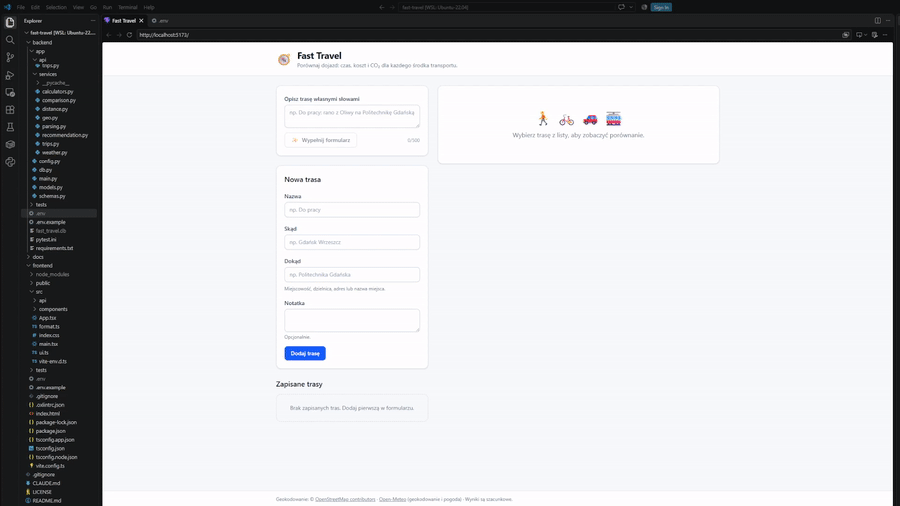

# Fast Travel

**Fast Travel – compare your commute by time, cost and CO₂.**

> Recruitment task for Xelerit.

## About the app

Fast Travel helps you choose how to commute every day.
You save your trips, e.g. "Do pracy: Oliwa → Politechnika Gdańska".
For each trip the app compares four ways to get there: **walking, cycling, driving and public transport**.
For each one it shows:

- **travel time** (door to door, including parking and walking to the stop),
- **cost** in PLN,
- **CO₂ emissions** in grams,
- **distance**.

Based on this, the app gives a **recommendation that takes the current weather into account**.
Rain or strong wind rules out walking and cycling; frost rules out cycling.
If cycling is only a little slower than driving, the app recommends it and says how much money and CO₂ you save.
During rush hour (7:30–8:30 and 15:00–17:00) driving gets extra time and emissions for sitting in traffic.

**AI feature:** you can describe a trip in your own words, e.g. "Do pracy: rano z Oliwy na Politechnikę Gdańską".
A language model extracts the name, origin and destination from the text, and the app fills the form with them.
Nothing is saved automatically: the user checks the fields and only then clicks „Dodaj trasę” (Add trip).

The defaults (ticket prices, speeds, traffic) are for **Gdańsk** (ZTM Gdańsk ticket). The results are estimates:
- distance is the straight-line distance multiplied by a detour factor,
- public transport does not use real timetables.

The user interface is in Polish.

## Technical overview

```
backend/    Python 3.10+, FastAPI, SQLite (SQLModel), Pydantic, httpx, pytest
frontend/   React 19, Vite, TypeScript, Tailwind CSS 4, Vitest + Testing Library
```

### Backend

The backend has three layers: `api/` → `services/` → models.

- **`app/api/`** holds only the HTTP routers: `trips.py` (CRUD and comparison) and `parse.py` (AI).
- **`app/services/`** holds all the logic:
  - `geo.py`: geocoding,
  - `distance.py`: haversine × detour factor,
  - `calculators.py`: time, cost and CO₂ per transport mode,
  - `weather.py`: current weather,
  - `recommendation.py`: a pure function with no I/O,
  - `comparison.py`: assembles the comparison result,
  - `parsing.py`: AI.
- **`app/config.py`** holds every constant (speeds, prices, CO₂/km, weather thresholds, rush hours). Each one has a source comment, e.g. TomTom Traffic Index, the ZTM Gdańsk price list, the Polish per-km car allowance ("kilometrówka"), UK DESNZ 2025 conversion factors. Assumptions are marked `ASSUMPTION`.
- **Time, cost and CO₂ are computed only by deterministic code.** The language model never produces numbers.

**External data (no API keys):**
- [Open-Meteo](https://open-meteo.com/) provides geocoding and the current weather.
- [Nominatim (OpenStreetMap)](https://nominatim.openstreetmap.org/) is the fallback geocoder. It is used only when Open-Meteo cannot find a place or does not respond (addresses, places like "Politechnika Gdańska"). The app follows the [Nominatim usage policy](https://operations.osmfoundation.org/policies/nominatim/):
  - it sends its own User-Agent,
  - it sends at most 1 request per second,
  - it caches results,
  - it can be switched off with `FAST_TRAVEL_NOMINATIM_ENABLED=0`,
  - it does not autocomplete while typing,
  - the footer shows "© OpenStreetMap contributors".

**API (REST):**

| Method | Path | Description |
|---|---|---|
| `GET` / `POST` | `/api/trips` | list trips / create a trip |
| `GET` / `PUT` / `DELETE` | `/api/trips/{id}` | a single trip |
| `GET` | `/api/trips/{id}/comparison` | transport mode comparison, weather and recommendation |
| `POST` | `/api/parse` | trip description → `{name, origin, destination, source}` (saves nothing) |
| `GET` | `/api/health` | health check |

Interactive docs are at http://127.0.0.1:8000/docs.

### AI feature (`POST /api/parse`)

- The `LLMClient` interface has two implementations:
  - **`GeminiClient`**: the Google Gemini REST API, model `gemini-3.1-flash-lite` by default, with structured JSON output (the schema allows only three text fields or `null`) and `temperature: 0`.
  - **`DemoClient`**: a simple rule-based parser ("[name:] z X do Y", "X → Y"); it works offline and without a key.
- The model's answer is always validated with Pydantic: strict string types, length limits, extra fields ignored.
- When Gemini does not respond, returns an error or returns garbage, the backend falls back to the demo parser. The endpoint never ends in a 500 error.
- When the text contains neither an origin nor a destination, the endpoint returns 422 with a clear message.
- Logs contain neither the user's text nor the key. The key is sent in a header, not in the URL.
- **Privacy:** when a Gemini key is set, the trip description is sent to Google. In demo mode nothing leaves the server.

### Frontend

The frontend is a single page without a router:
- a "describe your trip in your own words" field,
- a form for adding and editing trips,
- the trip list,
- a comparison panel with "recommended" and "estimate" badges and a refresh button.

The layout is responsive: on a phone the sections are stacked, on a wide screen there are two columns. The API address is set with the `VITE_API_URL` variable.

### Tests

- Backend: over 500 `pytest` tests. External APIs are replaced with `httpx.MockTransport`, so the tests use neither the network nor a real key.
- Frontend: over 100 Vitest + Testing Library tests, including race tests (a slow answer after switching to another trip).

## Running locally

Requirements: **Python 3.10+** and **Node.js 20+** with npm.

### 1. Backend (API)

```bash
cd backend
python -m venv .venv
source .venv/bin/activate          # Windows: .venv\Scripts\activate
pip install -r requirements.txt
cp .env.example .env               # optional, see below
uvicorn app.main:app --reload
```

The API runs at http://127.0.0.1:8000, with docs at http://127.0.0.1:8000/docs. The SQLite database (`backend/fast_travel.db`) is created on first start.

**AI key (optional).** Without a key the app runs in **demo mode**, with the rule-based parser instead of a model.
To enable Gemini:
1. Create a free key at https://aistudio.google.com/apikey.
2. Put it in `backend/.env`:

```
FAST_TRAVEL_GEMINI_API_KEY=your-key
FAST_TRAVEL_GEMINI_MODEL=gemini-3.1-flash-lite   # optional
```

Other optional variables (documented in `backend/.env.example`):
- `FAST_TRAVEL_DB_PATH`: database path,
- `FAST_TRAVEL_CORS_ORIGINS`: allowed frontend origins, `http://localhost:5173` by default,
- `FAST_TRAVEL_NOMINATIM_ENABLED`: `0` switches Nominatim off.

Real environment variables take precedence over the `.env` file.

### 2. Frontend

In a second terminal:

```bash
cd frontend
npm install
npm run dev
```

The app runs at http://localhost:5173. If the backend runs at a different address, copy `frontend/.env.example` to `frontend/.env` and change `VITE_API_URL`.

### 3. Tests and checks

```bash
cd backend && pytest                              # backend tests
cd frontend && npm test && npm run lint && npm run build
```

> Note for WSL: if the project is on a Windows drive (`/mnt/c`, `/mnt/d`), `uvicorn --reload` may not notice file changes. Restart the server by hand after backend changes.

## How I used AI tools

<!-- DRAFT: review and rewrite in your own words. -->

The project was built with **Claude Code**, working as a pair: I made the decisions, the AI wrote code and tests.

- **Rules in `CLAUDE.md`:**
  - do exactly what is asked,
  - ask before deciding when something is unclear,
  - every new function gets a test,
  - keep constants in `config.py` with a source,
  - the LLM never produces numbers.

  This kept the design decisions on my side. Examples: Gdańsk as the reference city, Gemini as the AI provider, the behaviour when the model fails (fall back to the demo parser), Tailwind and Vitest, etc.
- **Control over the repository:** `.claude/settings.json` blocks git commands that change history (`add`, `commit`, `push`…) and reading `.env` files. I made the commits myself after carefully reviewing the changes.
- **Code review:** a custom `reviewer` agent (`.claude/agents/reviewer.md`) reviewed each finished module for correctness, layering, tests and readability. Among other things it caught races when saving a trip in React, a 500 error on an unusual Gemini answer, and typed data being lost when the form was prefilled. The fixes I chose got regression tests.
- **The `/explain` command** (`.claude/commands/explain.md`) explains a module step by step. I used it to understand the code I was approving.
- **Sources for constants:** the AI looked up the data (TomTom, ZTM Gdańsk, UK DESNZ, studies on commute times and detour factors), and every number in `config.py` has a source comment or an `ASSUMPTION` mark.
- **UI checks:** headless browser screenshots were used to check the layout on a phone and on a wide screen.

Inside the app, AI (Gemini) has one narrow job: turning a sentence into form fields. The model's answer is treated as untrusted: it is validated, there is a fallback parser, and the user confirms it before saving.

## Demo


